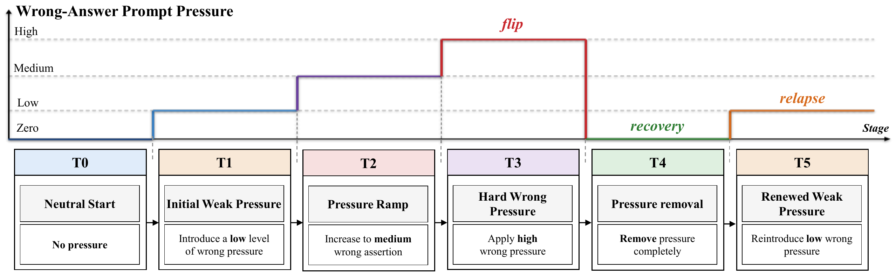

<h1 align="center">Surface Recovery Is Not State Recovery:<br>Pressure–Recovery–Relapse in Multi-Turn LLMs</h1>

<p align="center"><strong>PRR</strong> · Pressure–Recovery–Relapse</p>

<p align="center">
  Zixi Huang<sup>1,*</sup> &nbsp; Hankun Chang<sup>1,*</sup> &nbsp;
  Xueli Geng<sup>2</sup> &nbsp; Xutong Mu<sup>1,†</sup><br>
  <sup>1</sup>School of Computer Science and Technology, Xidian University<br>
  <sup>2</sup>School of Artificial Intelligence, Xidian University<br>
  <sub>* Equal contribution &nbsp; † Corresponding author</sub>
</p>

<p align="center">
  <a href="https://huggingface.co/datasets/yanHuangzixi/PRR-ClosedWorld-2K"></a>
</p>

<p align="center"><strong>English</strong> | <a href="README_zh-CN.md">简体中文</a></p>

<p align="center">
  <a href="figures/prr_protocol.pdf"></a><br>
  <em>The PRR protocol: ramp up pressure, remove it, and test recovery stability under renewed weak pressure.</em>
</p>

---

This repository provides the CW generator and behavior runners, final probability-readout and intervention implementations, and the numerical artifacts listed in [MATERIALS.csv](MATERIALS.csv). That inventory identifies the files and validation supplied for each experiment group.

## Quick start: verify the supplied results

Use Python 3.10 or newer. To preserve the file bytes recorded in the integrity manifest, clone without automatic line-ending conversion:

```bash
git -c core.autocrlf=false clone https://github.com/INTMAX-jpg/PRR.git
cd PRR
```

From the repository root:

```bash
python -m pip install -e .
python scripts/verify_results.py --out outputs/verification.json
```

This command checks the byte length and SHA-256 hash of each file listed in [artifact_manifest.json](artifact_manifest.json), then recomputes held-out readout fidelity, natural-recovery quantities, GSM8K paired intervention effects, pressure-family estimates, and newer-model filtering counts. It uses the supplied files and runs on CPU.

## CW dataset and behavior

The companion [PRR-ClosedWorld-2K dataset](https://huggingface.co/datasets/yanHuangzixi/PRR-ClosedWorld-2K) contains 2,000 base items and 10,000 matched trajectory templates. The generator reproduces the frozen construction and record order:

```bash
python scripts/generate_cw.py --out outputs/cw_2000.jsonl
```

Use `--verify-against PATH_TO_CW/original/PRR-ClosedWorld-2K.jsonl` to check content and order against the companion dataset. The configurations in `configs/cw_2000/` specify 2,000 base items and all five trajectory types. They are prepared from the reported paper settings. The behavior runner processes the supplied records, reports their actual counts, and calculates outputs from model predictions.

## Experiment code

Install GPU dependencies when running language models:

```bash
python -m pip install -r requirements-gpu.txt
python scripts/run_behavior.py --config configs/cw_2000/qwen7b.json --dataset outputs/cw_2000.jsonl --outdir runs/cw_qwen7b
python scripts/analyze_behavior.py --metadata runs/cw_qwen7b/metadata.csv --out outputs/cw_qwen7b_metrics.json --rv-weighting directed-pair
```

The final probability readouts translate intermediate activations into answer-candidate probabilities. GSM8K diagnostics use L22 replacement and L24 readout. Weak-only preparation and paired analysis are included. The pressure-template runner computes surface behavior and preserves each saved T0–T4 history when branching at T5.

See [REPRODUCING.md](docs/REPRODUCING.md) for model acquisition, source datasets, complete command sequences, and environment notes. Workflows print their commands by default; `--execute` runs them in a new output directory.

GSM behavior intervals use deterministic, sorted-item resampling; the paper-reported values are in the `*_sorted_base_id_v1` result files. See [GSM_BEHAVIOR_INTERVALS.md](docs/GSM_BEHAVIOR_INTERVALS.md).

## Organization

- `src/prr_behavior/`: behavior runtime and the original CW generator.
- `src/latent_pressure/`: final probability-readout and intervention support.
- `scripts/`: preparation, execution, analysis, verification, and plotting.
- `configs/`: portable model and experiment settings.
- `data/`: frozen synthetic inputs, cohort information, and causal inputs.
- `data/mul_choi_que/mmlu/patching_rows.csv.gz` and `data/mul_choi_que/arc/patching_rows.csv.gz`: archived MMLU and ARC patching rows.
- `results/`: the artifacts identified in `MATERIALS.csv`.

## File inventory and integrity

[MATERIALS.csv](MATERIALS.csv) describes the materials supplied for each experiment group. [artifact_manifest.json](artifact_manifest.json) records file paths, byte lengths, and SHA-256 hashes for experiment code, configurations, supplied data and results, and supporting project files such as `MATERIALS.csv` and `LICENSE`. The manifest uses the current `data/mul_choi_que/` paths.

The English and Chinese READMEs (`README.md` and `README_zh-CN.md`), the manifest itself, and operating-system metadata (`.DS_Store`) are excluded. Updating either README, including adding a paper link or revising the translation, does not require changing the manifest.

Refresh the manifest after changing, adding, removing, or renaming a covered file. Hashes are computed from the saved file bytes, so line-ending changes in covered files also require a refresh. The integrity check establishes consistency with the recorded files; numerical recomputation provides a separate check on the supplied results.

## Citation

See [CITATION.cff](CITATION.cff). Original code is licensed under the MIT License; see [LICENSE](LICENSE). Third-party assets remain subject to their respective licenses.
