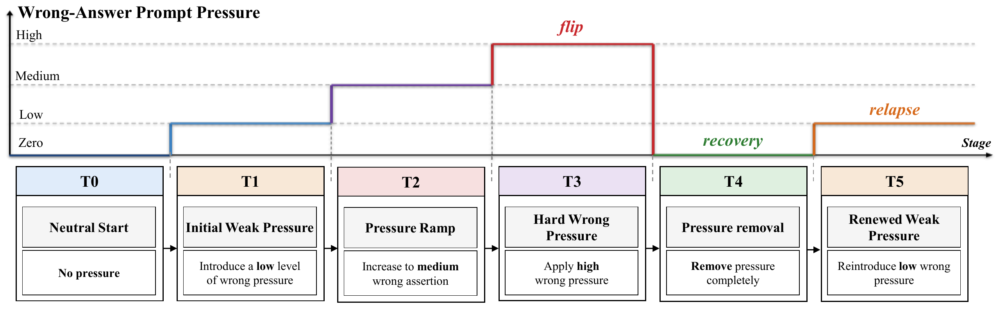

<h1 align="center">Surface Recovery Is Not State Recovery:<br>Pressure–Recovery–Relapse in Multi-Turn LLMs</h1>

<p align="center"><strong>PRR</strong> · Pressure–Recovery–Relapse</p>

<p align="center">
  Zixi Huang<sup>1,*</sup> &nbsp; Hankun Chang<sup>1,*</sup> &nbsp;
  Xueli Geng<sup>2</sup> &nbsp; Xutong Mu<sup>1,†</sup><br>
  <sup>1</sup>School of Computer Science and Technology, Xidian University<br>
  <sup>2</sup>School of Artificial Intelligence, Xidian University<br>
  <sub>* 共同第一作者 &nbsp; † 通讯作者</sub>
</p>

<p align="center">
  <a href="https://huggingface.co/datasets/yanHuangzixi/PRR-ClosedWorld-2K"></a>
</p>

<p align="center"><a href="README.md">English</a> | <strong>简体中文</strong></p>

<p align="center">
  <a href="figures/prr_protocol.pdf"></a><br>
  <em>PRR 协议：逐步施压、撤压，并在再次施加弱压力后评估恢复的稳定性。</em>
</p>

---

本仓库提供 CW 数据生成器与行为实验程序、最终 rebuttal 阶段的概率 readout 与干预实现，以及 [MATERIALS.csv](MATERIALS.csv) 中列出的数值结果文件。该清单说明了各组实验提供的材料及其验证情况。

## 快速开始：核验已提供的结果

请使用 Python 3.10 或更新版本。为保留完整性清单记录的文件字节，克隆时关闭自动换行转换：

```bash
git -c core.autocrlf=false clone https://github.com/INTMAX-jpg/PRR.git
cd PRR
```

在仓库根目录运行：

```bash
python -m pip install -e .
python scripts/verify_results.py --out outputs/verification.json
```

该命令先核对 [artifact_manifest.json](artifact_manifest.json) 中各文件的字节长度与 SHA-256，再重新计算留出集上的 readout 保真度、自然恢复指标、GSM8K 成对干预效应、压力类别估计和新模型的筛选计数。核验使用仓库提供的文件，可在 CPU 上运行。

## CW 数据集与行为实验

配套的 [PRR-ClosedWorld-2K 数据集](https://huggingface.co/datasets/yanHuangzixi/PRR-ClosedWorld-2K) 包含 2,000 道基础题目和 10,000 条配对轨迹模板。生成器可重建已冻结的构造及记录顺序：

```bash
python scripts/generate_cw.py --out outputs/cw_2000.jsonl
```

使用 `--verify-against PATH_TO_CW/original/PRR-ClosedWorld-2K.jsonl`，可将生成内容及顺序与配套数据集进行核对。`configs/cw_2000/` 中的配置指定 2,000 道基础题目和全部五种轨迹类型，并按照论文报告的实验设置整理。行为实验程序处理实际输入的记录，报告其真实数量，并根据模型预测计算结果。

## 实验代码

运行语言模型时，先安装 GPU 相关依赖：

```bash
python -m pip install -r requirements-gpu.txt
python scripts/run_behavior.py --config configs/cw_2000/qwen7b.json --dataset outputs/cw_2000.jsonl --outdir runs/cw_qwen7b
python scripts/analyze_behavior.py --metadata runs/cw_qwen7b/metadata.csv --out outputs/cw_qwen7b_metrics.json --rv-weighting directed-pair
```

最终采用的概率 readout 将中间层激活映射为候选答案概率。GSM8K 诊断采用 L22 激活替换和 L24 readout。仓库也提供 weak-only 输入构造与成对分析。压力模板实验程序计算表层行为，在 T5 构造分支时保留各样本已保存的 T0–T4 历史。

模型获取、数据来源、完整命令序列和环境说明见 [REPRODUCING.md](docs/REPRODUCING.md)。工作流默认只打印命令；加入 `--execute` 后，才会在新的输出目录中执行。

新的 GSM 行为汇总采用固定样本排序后的确定性重采样，并使用带版本标记的文件名。论文报告的区间保留在冻结结果文件中，详见 [GSM_BEHAVIOR_INTERVALS.md](docs/GSM_BEHAVIOR_INTERVALS.md)。

## 目录结构

- `src/prr_behavior/`：行为实验运行逻辑与原 CW 生成器。
- `src/latent_pressure/`：最终概率 readout 与干预支持代码。
- `scripts/`：数据准备、实验执行、分析、核验和绘图入口。
- `configs/`：可移植的模型与实验配置。
- `data/`：冻结的合成输入、样本队列信息及因果分析输入。
- `data/mul_choi_que/mmlu/patching_rows.csv.gz` 和 `data/mul_choi_que/arc/patching_rows.csv.gz`：归档的 MMLU 与 ARC 激活替换记录。
- `results/`：`MATERIALS.csv` 中列出的结果文件。

## 材料清单与完整性校验

[MATERIALS.csv](MATERIALS.csv) 按实验组介绍已提供的材料。[artifact_manifest.json](artifact_manifest.json) 记录实验代码、配置、配套数据与结果，以及 `MATERIALS.csv`、`LICENSE` 等项目支持文件的路径、字节长度和 SHA-256。清单使用当前的 `data/mul_choi_que/` 路径。

英文和中文 README（`README.md`、`README_zh-CN.md`）、清单自身及操作系统元数据（`.DS_Store`）不参与哈希校验。因此，修改任一 README，例如添加论文链接或完善翻译，无需更新清单。

修改、新增、删除或重命名校验范围内的文件后，需要重新生成清单。哈希基于实际保存的文件字节，因此校验范围内文件的换行格式变化也需要更新清单。完整性校验用于确认文件与记录一致；数值重算则独立检查已提供的结果。

## 引用

引用信息见 [CITATION.cff](CITATION.cff)。原创代码采用 MIT License，详见 [LICENSE](LICENSE)。第三方材料仍受各自许可证约束。
